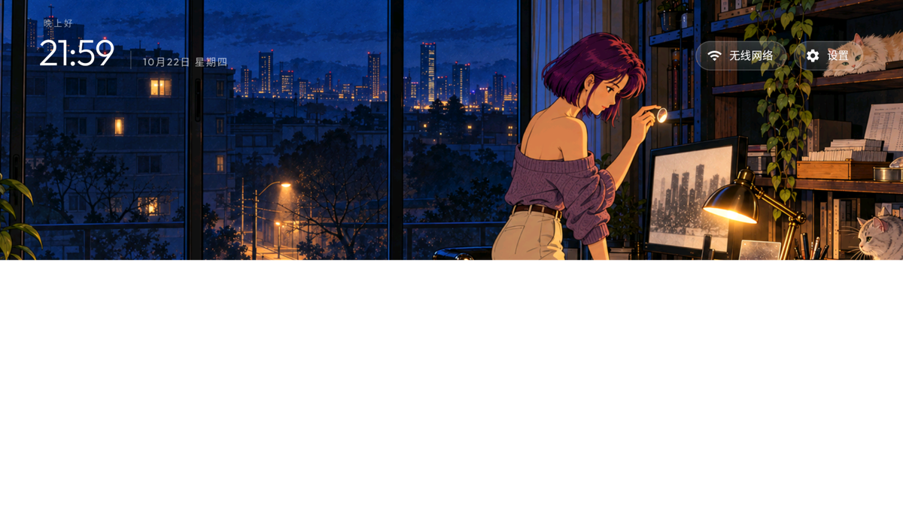
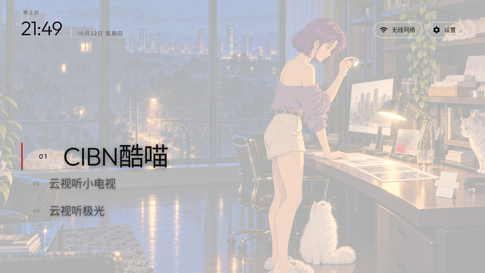
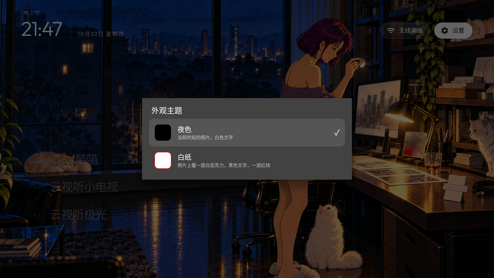

# CleanYourTV, Zen list

A personal fork of [CleanYourTV](https://github.com/Gathin23/cleanyourtv) (MIT). The debloat tools,
the TV lists and the restore scripts are the original project's; the launcher is rewritten here as a
Zen list, and this repository is maintained on its own, not merged back upstream.

**The launcher**: instead of a tile grid, a list of app names in large type with a fixed selection
line. A remote wallpaper from the daily wall sits behind it, and two looks can be switched on the TV
without a rebuild.

| | |
|---|---|
|  |  |
| *Night — the hour's picture, white type* | *Paper — the picture under white acrylic, black type* |



## What it does

- **A Zen list of app names**, not tiles: one row per app, a fixed line in the middle, rows that
  dissolve towards the edges, and a selection that leads the eye instead of jumping to it.
- **A remote wallpaper** pulled from a signed index, drifting against the list as it scrolls, and
  the top bar drifting with it.
- **Two themes, switchable on the TV**: *Night* (the picture, white type) and *Paper* (the picture
  under a white acrylic veil, black type, red only as a hairline). The choice is a preference, so it
  survives a reboot.
- **One Settings press** opens the launcher's own menu: 简洁桌面设置 / 外观主题 / 模块卡片 /
  电视系统设置. No hidden long press.
- **TCL-friendly**: on firmware that answers no `android.settings.SETTINGS` intent, the menu's TV
  settings row opens the vendor's own settings app instead of reporting it as unsupported.
- **Debloat and restore** still work as in the original project: the lists in [`examples/`](examples/)
  and the scripts in [`tools/`](tools/).

## Install on a TV

The launcher is `com.gathin.tvhome`. It needs JDK 17 and Android SDK platform 34.

```bash
cd launcher
JAVA_HOME=$(/usr/libexec/java_home -v 17) ./gradlew assembleRelease
```

Then, with the TV's network debugging on and the computer authorised:

```bash
cd ..
TV_HOST=<tv-ip> tools/venv/bin/python -I tools/b64push.py \
  launcher/app/build/outputs/apk/release/app-release.apk /data/local/tmp/tvhome.apk
TV_HOST=<tv-ip> tools/venv/bin/python -I tools/tv.py 'pm disable-user --user 0 com.android.packageinstaller'
TV_HOST=<tv-ip> tools/venv/bin/python -I tools/tv.py 'pm install -r /data/local/tmp/tvhome.apk'
TV_HOST=<tv-ip> tools/venv/bin/python -I tools/tv.py \
  'pm enable com.android.packageinstaller; rm -f /data/local/tmp/tvhome.apk; am start -W -n com.gathin.tvhome/.MainActivity'
```

TCL's China-market firmware refuses the install while `com.android.packageinstaller` is enabled; that
is why the installer is disabled for the install and restored straight after.
`launcher/build-and-install.sh` does the same in one step (`TV_HOST=<tv-ip> launcher/build-and-install.sh`).

## Using it

- **Settings**: press the gear once. The menu has the launcher settings, the theme picker, module
  cards and the TV's own settings.
- **Appearance**: a list of themes with a swatch of each one's ground, a name, one line about it and
  a tick on the current one. Picking one repaints Home immediately.
- **Launcher settings** (`launcher/app/src/main/res/values/config.xml`, or the on-TV screen): dock
  order, hidden apps, the Live TV package, apps per row, animations and advanced effects.

## TV lists

The lists in [`examples/`](examples/) are the original project lists, unchanged. Each folder is one model with the packages that are safe to disable on that firmware.

<details>
<summary><strong>The full list</strong></summary>

| TV | OS |
|---|---|
| AiPro2K (Expressluck, dongnae; Changhong AI PONT family) | Android TV 14 |
| Amazon Fire TV Stick 4K, 1st gen 2018 (AFTMM, mantis) | Fire OS 6.7.1.1 / Android 7.1 |
| BenQ E55-735 (Changhong AI PONT, DVB96BQ) | Google TV 14 |
| BenQ E55-750 (Changhong AI PONT, DVB96BQ) | Google TV (Android 11) |
| CHiQ AI PONT (Changhong GTVU65, dangni, MediaTek mt5867) | Google TV 14 |
| CHiQ AI PONT (DVB93CQ) | Android TV 11 |
| Chromecast with Google TV 4K (sabrina) | Google TV 14 |
| Haier H32S80EFX (MatrixTV CE, HRT56EU, deto, MediaTek), Thailand | Google TV 14 |
| Hisense HiSmartTV A4 (xiaoyushan, MStar m7322), Android 11 firmware RTT2.221108.001 | Android TV 11 |
| Hisense HiSmartTV A4 (xiaoyushan, MStar m7322), India | Android TV 9 |
| Hisense SmartTV 4K FFM (huangshan, MediaTek) | Android TV 10 |
| Hisense U75 (hengshan, MediaTek), Latin America | Google TV 12 |
| Hitachi 65QLEDSM20 (MTC, bangbae, MediaTek m7322), Australia | Android TV 11 |
| Hitachi CDH-LE32SMART21 (TCL-built C06, C06_2K_GB, MediaTek MT9221, 1 GB), Argentina | Android TV 11 |
| Insignia 55" F30 4K Fire TV (NS-55F301NA25, AFTDCT31, duckie) | Fire OS 7 / Android 9 |
| Kalley R10G (device R10G, product ACER_FFM, MOKA, Realtek RTD2875P), Latin America | Google TV 14 |
| NVIDIA SHIELD TV Pro 2019 (P2897, mdarcy) | Android TV 11 |
| OnePlus TV (D00, Dubai) | Google TV 14 |
| onn 4K Streaming Box (2023, Walmart; YOC, Amlogic), US | Google TV 14 |
| Panasonic 4KTV-JUP (Jupiter_PA, MediaTek) | Android TV 11 |
| Panasonic TH-40HS550K (Skyworth-built, GS655 shibuya, MediaTek) | Android TV 11 |
| Philips 50PUS8517/12 (TP Vision, PH1M_EA_9970A, MediaTek MT5895), Europe | Android TV 11 |
| Philips 55PUS7503/12 (TP Vision TPM171E, PH7M_EU_5596, MediaTek MT5891), Europe | Android TV 8.0 |
| Philips R8G Google TV (MOKA, whitefield, Realtek RTD2851F), US | Google TV 14 |
| Philips Smart 4K TV (Skyworth, eleonas, MediaTek), India | Google TV 14 |
| PRISM+ Q65 Ultra 2026 QLED 4K AI Google TV (R10G, PRISMPLUS_FFM, MOKA, Realtek RTD2875 SoC, RTD6748 platform) | Google TV 14 |
| RCA AI PONT SA (Changhong, redwood, ISDB92RC; also sold as realme 40-inch) | Android 14 |
| Redmi TV (MiTV-ANTL0, starwars) | Android 5.1.1 (not Android TV) |
| SANYO ATV R2 (SCBC, Realtek RTD285O) | Android TV 9 |
| Skyworth SWTV-21AE (sunnyvale, MediaTek) | Android TV 14 |
| Skyworth SWTV-24NA-4K NF (eleonas, MediaTek mt5896), US | Google TV 14 |
| Sony BRAVIA 4K AE2 (BRAVIA_AE2, MediaTek MT5897), North America | Google TV 14 |
| Sony BRAVIA 4K GB (BRAVIA_ATV2_EU, BRAVIA_ATV2) | Android TV 9 |
| Sony BRAVIA 4K GB (BRAVIA_ATV2_UC, MediaTek mt5891) | Android TV 9 |
| Sony BRAVIA 4K UR2 (BRAVIA_UR2_4K, MediaTek) | Android TV 10 |
| Sony BRAVIA 4K VH2 (KD-55X80J, BRAVIA_VH2, MediaTek), EU | Google TV 12 |
| Sony BRAVIA 9 II (K-65XR90M2, BRAVIA_AE3, MediaTek MT5838) | Google TV 14 |
| Sony BRAVIA BF1 (BRAVIA 2 II class, BRAVIA_BF1_4K_A, MediaTek) | Google TV 12 |
| Sony BRAVIA KD-55X85J (2021, BRAVIA_VH2, MediaTek MT5895), South America | Google TV 12 |
| Sony BRAVIA KD-65X80J (2021, BRAVIA_VH2, MediaTek), India | Google TV 10 |
| Sony BRAVIA KD-65X9300D (2016, SVP-DTV15, MediaTek), Asia-Pacific | Android TV 8.0 |
| Sony BRAVIA VU31 4K (BRAVIA_VU31_4K, Realtek), India | Google TV 14 |
| Sony BRAVIA XBR-65X900E (2017, BRAVIA_ATV2) | Android TV 9 |
| Sony BRAVIA XBR-65X900F (2018, BRAVIA_ATV3_4K, MediaTek MT5891), US/Canada | Android TV 9 |
| Stellamore T950S projector (Droidlogic be30a3, Amlogic txhd2) | Android 13 |
| TCL 40S5400A (C06, C06_2K_GB, MediaTek MT9221, 1 GB) | Android TV 11 |
| TCL 43C645 (Smart TV Pro, Realtek RTD2851 / R51MT05, V8-R51MT05-LF1V652) | Google TV launcher on Android TV 11 |
| TCL 50EP680 (Europe, BeyondTV, Realtek rtd285o) | Android TV 11 |
| TCL 55" 4K Google TV, 2023 (G10, G10_4K_US_NF); also TCL 55P6K, Spain (G10_4K_GB_NF_32BIT) | Google TV 12 |
| TCL 55Q10G Pro (China, tcl_mt5879_cn, MediaTek MT9952) | Android TV 11 |
| TCL 55S470G (G10, G10_4K_US_NF, Realtek), US | Google TV 12 |
| TCL 65C725 (Smart TV Pro, BeyondTV4) | Android TV 11 |
| TCL 65C735 (Smart TV Pro, G05, MediaTek), France | Google TV 11 |
| TCL ak30a5 (China, Amlogic) | Android TV 9 |
| TCL BeyondTV (India) | Android TV 9 |
| TCL BeyondTV, EU/Nordic (Realtek RTD2851, V8-R851T02-LF1V606) | Android TV 9 |
| TCL BeyondTV2 (Latin America / Brazil, Realtek RTD2851) | Android TV 9 |
| TCL C755 QD-Mini LED, 2024, Australia (G08, MediaTek tcl9618) | Google TV 14 |
| TCL QM6K Pro, 2025 (G08, MediaTek tcl9618) | Google TV 14 |
| TCL Smart TV Pro (G05, G05_4K_US, MediaTek MT5889) | Google TV 11 |
| TCL UnionTV, Latin America (TCL-built like Thomson 32HE5800, Realtek RT2841) | Android TV 9 |
| Thomson 32HE5800 (TCL-built UnionTV, Realtek RT2841), Spain | Android TV 9 |
| Toshiba Fire TV (AFTHA004, hazel) | Fire OS 7 / Android 9 |
| Vu 4K (HVCL, lushan, MediaTek), India | Google TV 12 |
| XGIMI Horizon S Pro projector (XK03H, xgimigalileo, MediaTek) | Android TV 11 |
| Xiaomi Mi Box S (MIBOX4, oneday), streaming box | Android TV 9 |
| Xiaomi Mi Box S 2nd gen (MiTV-AFKR0, jaws), streaming box | Google TV 11 |
| Xiaomi Mi TV (MiTV-MOOQ0, croods) | Android TV 10 |
| Xiaomi Mi TV 4A (MiTV-MOOQ1) | Android TV 10 |
| Xiaomi MiTV-AESP0 stick (aquaman, 1 GB) | Android TV 9 |
| Xiaomi MiTV-ASTP1 (maverick), China firmware 2.40.641.0514.cn, 1 GB RAM, 720p | Android TV 9 (CN build) |
| Xiaomi MiTV-AXFR1 (rango, Amlogic, 1 GB), India | Android TV 11 |
| Xiaomi MiTV-AXSO0 (dangal; Mi TV 4C Pro 2019 / 4A Pro) | Android TV 9 |
| Xiaomi MiTV-AXSO2 (dangalUHD, India, 2 GB) | Android TV 9 |
| Xiaomi MiTV-MOOR2 (venom, MediaTek) | Google TV 11 |
| Xiaomi MiTV-MOSR4 (irobot, MediaTek) | Google TV 11 |
| Xiaomi MiTV-MSSP3 (machuca, MediaTek) | Android TV 11 |
| Xiaomi MiTV-MSSP3 (machuca, MediaTek), Android 9 firmware PI.7524 | Android TV 9 |
| Xiaomi TV A Pro 75" 2026 (MiTV-MZTU0, river, MediaTek) | Google TV 14 |
| Xiaomi TV Box S 3rd gen (MiTV-AFMU0, twilight, Amlogic), streaming box | Google TV 14 |

</details>

## Debloat and restore

Everything the original project documents still applies; the scripts and lists are unchanged.

```bash
python3 -m venv tools/venv && tools/venv/bin/pip install -r tools/requirements.txt
TV_HOST=<tv-ip> tools/venv/bin/python -I tools/tv.py --probe
TV_HOST=<tv-ip> tools/disable.sh examples/<model>/debloat.txt
TV_HOST=<tv-ip> tools/restore.sh examples/<model>/debloat.txt
```

`tools/disable.sh` records what it changed under `~/.cleanyourtv/` before touching anything, so
`tools/restore.sh` can put the TV back.

## Tests

```bash
cd launcher && JAVA_HOME=$(/usr/libexec/java_home -v 17) ./gradlew test
```

## Licence and credit

MIT, see [`LICENSE`](LICENSE). The debloat tooling, the TV lists and the original launcher come from
[Gathin23/cleanyourtv](https://github.com/Gathin23/cleanyourtv), whose contributors are credited there.
The Outfit typeface is under the SIL Open Font License, see `launcher/FONT-LICENSE-OFL.txt`.

